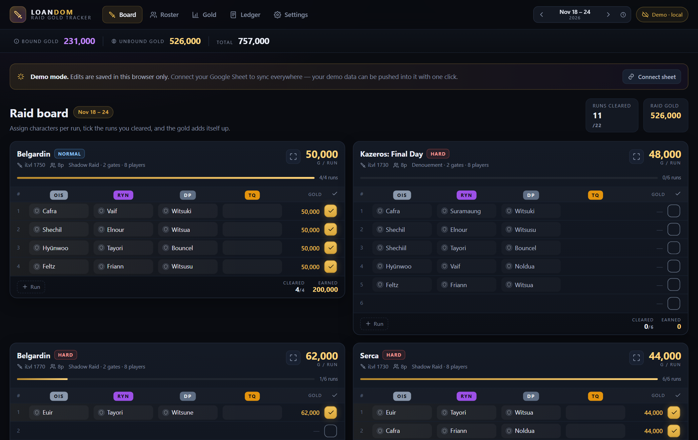

# LOANDOM

**Live:** https://hauitsu.github.io/LOANDOM/ — demo data until you connect your sheet.

A Lost Ark **weekly raid gold tracker** with a GUI that is actually pleasant to use — and a database that is just a Google Sheet.

- **Host:** GitHub Pages (static files, free, no server, no domain)
- **Database:** one Google Sheet you can still open and edit by hand
- **API:** Google Apps Script Web App (free, runs as you, no billing)
- **Build:** none. Plain HTML + ES modules + one CSS file.

It takes the original tracker sheet — four raid blocks, one column per roster owner, a checkbox per run, bound/unbound totals at the bottom — and turns it into a live board with character assignment, item-level checks, weekly limits and history.

```
GitHub Pages  ──fetch──▶  Apps Script Web App  ──▶  Google Sheet
   (UI)          JSON        (API + auth)              (data)
```



No database service, no VPS, no deploy secrets. The site is three folders of files; the "backend" is a script attached to the spreadsheet.

---

## What it does

**Raid board (the sheet, but alive)**
- Each raid is a card: payout, item level, difficulty, progress.
- Rows are runs; columns are roster owners; each cell is a character picker with search.
- Tick a run → gold counts instantly. Duplicate a run to reuse a party comp.
- Gold per run is editable per raid, and the game's tradable/bound split is a first-class field.

**Roster**
- Characters per owner with class and item level.
- **Paste a portrait from the clipboard** (or pick a file) in the character modal — uploaded to **Google Drive by the script** and stored as a file ID in the `Portraits` tab. No re-encoding: the original bytes are kept; the UI renders it at **50% of its natural size** in the character modal and inside a compact **104 × 144** frame in the roster tooltip, with the aspect ratio intact.
- Portraits appear in the character modal, a hover tooltip, and the assignment picker on the board — never as a cropped square.
- **Focus a single raid**: the expand button on any raid card (or `#/raid/<id>`) opens a full-width board for that raid, with larger rows and the same controls.
- Class badges use 30 bundled official vector emblems with an icon-and-name picker; custom class text still works. No runtime external-image dependency.
- "Can run" checks against every raid's item level.
- This-week usage chips per character, plus caps: **6 gold earners per roster**, **3 gold clears per character**.
- Flags duplicate characters in the same raid, below-item-level assignments and over-cap clears.

**Gold**
- The two numbers from the bottom of your sheet — **Bound** and **Unbound** — plus week history.
- Per-raid and per-owner breakdown.
- Two counting rules: *per run* (one payout per cleared row, like the sheet) or *per character* (every character in the run earns, like the game). Switchable, no data loss.

**Ledger**
- Manual gold outside raids (Una tokens, chaos gates, solo-mode bound gold, the sheet's standalone BOUND GOLD cell).
- Kept separate so raid math stays honest.

**Sync**
- Writes are optimistic and queued; a failed request keeps your change and shows a red pill with the reason.
- Polls the sheet every 20 s and on tab focus; **Sync now** forces it.
- Edit the spreadsheet by hand and the app picks it up. Rows typed by hand get IDs healed on the next read.
- Import/export JSON snapshots; push the whole local state into a blank sheet in one click.
- **Read key + invite links**: gate reads with a key, then hand out a **member link** (read-only) or an **editor link** (includes the PIN). No accounts, no repo changes.

**Keys, links and touch**
- `[` / `]` move one week, `T` jumps back to this week.
- The week lives in the URL (`?w=2026-11-18`), so a board, a raid focus or a ledger view is a link you can share and reload.
- On a phone every run gets a `⋯` button for duplicate/delete; nothing hides behind hover.
- Dialogs trap focus and restore it on close, Escape closes them, toasts announce themselves and every icon button has a name.

**Feedback**
- Every edit is optimistic: the row you touched updates at once, then shows a gold dot and a left edge until the sheet confirms it.
- A write that fails keeps your change, turns that row red and pins a banner with the reason and a **Retry** button — it does not vanish after four seconds.
- The header carries a status pill (**Saving… · 2**, **Not saved · 1**, **Synced 2 min. ago**) and a thin progress line during any round trip.
- Buttons that wait say what they are doing — Connecting…, Saving…, Pushing…, Resetting…, Syncing…, Pulling…, Importing… — and disable themselves until the answer arrives.
- `Reset sheet to demo data`, `Push data to sheet` and a sync both show a running banner (**Resetting the sheet…**) with the reason it takes time, then a plain result toast; a failure keeps the banner and **Retry** re-runs that same task.
- A reload paints the last board from a local snapshot before the scripts finish loading, so there is no loading screen on repeat visits; the app replaces it with fresh data a moment later.

**Offline & install**
- A service worker precaches the shell, every module and the class emblems, so the board opens with no network and repeat launches read from cache instead of the network.
- Navigations are cache-first; the HTML is refetched in the background and the "new version" banner appears only when the file actually changed. `sw.js` carries a `VERSION` — bump it on every deploy so the new files install atomically.
- The manifest ships PNG icons plus `apple-touch-icon`, so it installs to a home screen and opens standalone with the same cache.
- Offline, the header says so and any change stays queued until the connection returns.
- First paint is a skeleton of the board, and the connect form marks the field with an inline error instead of only a toast.

---

## Quick start

### 1. Try it locally (demo mode, no setup)

```bash
# any static server works
npx serve .
# or
python -m http.server 8080
```

Open the URL. The app loads a faithful copy of the original LOANDOM sheet (Belgardin NM/HM, Kazeros HM, Serca HM — 526,000 unbound + 231,000 bound) into `localStorage`. Everything is editable; nothing leaves the browser.

### 2. Deploy to GitHub Pages

This repository is already published from `main` / root at
<https://hauitsu.github.io/LOANDOM/>. For your own fork:

```bash
git remote add origin https://github.com/<you>/<repo>.git
git push -u origin main
```

Then **Settings → Pages → Build and deployment → Source: Deploy from a branch → `main` / `/ (root)` → Save**.

`.nojekyll` is already there, so the JS modules are served as-is. Your site appears at `https://<you>.github.io/<repo>/`.

### 3. Connect the sheet

Follow [SETUP.md](SETUP.md). Short version:

1. Google Sheet → **Extensions → Apps Script**, paste [`apps-script/Code.gs`](apps-script/Code.gs), run `setup()`.
2. **Deploy → New deployment → Web app** — execute as *Me*, access *Anyone*.
3. Paste the `/exec` URL into **Settings → Google Sheet** in the app.

If the sheet is blank, the app seeds it with whatever it currently shows. If it already has data, the app loads the sheet and your browser stops being the source of truth.

---

## Data model

Every tab is a plain table with a header row. The app tolerates hand edits and reordered columns (headers are matched by name).

| Tab | Columns | What it is |
| --- | --- | --- |
| `Config` | `key, value` | name, timestamps, app version |
| `Raids` | `id, name, short, difficulty, ilvl, goldTradable, goldBound, partySize, order, active, note` | raid catalog + payouts |
| `Players` | `id, name, tag, color, order` | the sheet's columns (OIS, RYN, DP, TQ) |
| `Characters` | `id, playerId, name, className, ilvl, goldEarner, active, notes, updatedAt` | rosters |
| `Runs` | `id, week, raidId, index, cleared, claims, note, updatedAt` | one row per run |
| `Assignments` | `id, runId, playerId, characterId, name, updatedAt` | one row per character in a run |
| `Ledger` | `id, week, kind, amount, source, note, playerId, characterId, updatedAt` | manual gold |
| `Portraits` | `key, mime, driveId, updatedAt` | character images stored in Drive (file IDs only, excluded from the main snapshot) |

A **week** is the ISO date of the Wednesday that opened it (`2026-11-11`). That is stable, sortable and readable inside a spreadsheet. Weekly reset is configurable (default Wednesday 06:00, browser local time).

Gold per run = `goldTradable + goldBound` when cleared. In *per character* mode it is multiplied by the number of characters in the run.

---

## How the "no server" trick works

GitHub Pages serves files only; it cannot receive a form post or hold a secret. Apps Script is the missing half:

- The script runs **inside your Google account**, with full access to the sheet.
- Deployed as a web app with `access: Anyone`, it answers `GET`/`POST` as JSON — a tiny API with no infrastructure.
- The site POSTs with `Content-Type: text/plain` so the browser skips the CORS preflight, which Apps Script cannot answer.
- Writes are guarded by a PIN stored in Script Properties. Reads are public unless you set a **read key** (`setReadKey`), in which case the URL alone returns nothing.
- **Sheet sharing is not an access control for the API.** The script runs as the owner, so it can read a private sheet. Set the sheet to *Restricted* to stop Drive-level sharing, and treat the deployment URL + read key as the real read credential. See [SETUP.md § Security](SETUP.md#security-notes) for the hardening checklist (long keys, URL hygiene, rotation).
- Version history, permissions and backups are Google's problem, not yours.

Cost: 0. Cold start: a second or two on the first request after idle.

---

## Repository layout

```
index.html                 app shell
assets/css/app.css         the entire design system
assets/classes/            30 bundled class emblems + source/licence manifest
assets/js/
  app.js                   shell, routing, delegated events
  classes.js               canonical class registry, aliases, colours
  classbadge.js            local emblem / fallback crest
  classpicker.js           accessible grouped class picker
  store.js                 state, optimistic mutations, sync queue
  api.js                   Apps Script client + localStorage adapter
  model.js                 normalisation, gold math, week validation
  seed.js                  the original sheet as demo data
  ui.js                    toasts, modals, character popover
  util.js, icons.js        helpers + inline SVG
  views/                   board, roster, summary, ledger, settings
apps-script/
  Code.gs                  the whole backend (Apps Script, ES5-safe)
  appsscript.json          web app manifest
  tests/run.mjs            offline test suite against a fake Sheets runtime
docs/                      screenshots
SETUP.md                   sheet + deployment walkthrough
```

---

## Tests

The backend logic is exercised offline against a small fake of the Apps Script
runtime, so a bad change fails before it ever reaches your sheet:

```bash
node apps-script/tests/run.mjs
```

Class registry, emblem coverage, alias and local-asset checks:

```bash
node --experimental-vm-modules apps-script/tests/class-icons.mjs
```

The portrait path (paste → save → reopen → reload) runs the real browser modules
against the same fake backend, so it needs the VM modules flag:

```bash
node --experimental-vm-modules apps-script/tests/portrait-reload.mjs
```

It covers setup, `replaceAll`, revision short-circuiting, run toggles, cell
assignment (including auto-creating characters), healing hand-typed sheet rows,
cascade deletes, PIN enforcement and batched upserts.

The gold math is pure and easy to check by hand: the demo reproduces the sheet
below exactly.

---

## Verified numbers

The demo reproduces the sheet exactly:

| Raid | Payout | Clears | Gold |
| --- | ---: | ---: | ---: |
| Belgardin NM | 50,000 | 4/4 | 200,000 |
| Belgardin HM | 62,000 | 1/6 | 62,000 |
| Kazeros HM (Final Day) | 48,000 | 0/6 | 0 |
| Serca HM | 44,000 | 6/6 | 264,000 |
| **Unbound total** | | | **526,000** |
| Bound (manual entry) | | | **231,000** |

Payout values are editable in **Settings → Raids & payouts** because patches move them. Defaults follow the September/October 2026 Western values (Dimensions Unbound + Arbiter of Death): Belgardin 50k/62k, Final Day Hard 48k, Serca Hard 44k.

**Provenance:** raid item levels and payouts come from public tables and release notes. **Character item levels in the demo are invented placeholders** — the original screenshot does not contain them. They exist only so the eligibility checks have something to compare against; replace them in **Roster** with your real values. Gold totals do not depend on them.

---

## Limitations (on purpose)

- Sync is **last-write-wins per row**, not real-time collaboration.
- Polling is 20 s, not a websocket. There is no server to hold one.
- The PIN and read key are stored in plain text in each browser's `localStorage`. They gate the API, not individual accounts.
- No PvP/auction tracking, no honing calculator, no market prices. This is a gold ledger.

---

## Credits

Built for a static GitHub Pages deploy with a Google Sheet as the database. Lost Ark and its content belong to Smilegate RPG / Amazon Games; this is an unofficial fan tool. Raid payout defaults were checked against the community weekly-gold tables (Lost Mokokos, September 2026) and the official release notes for Dimensions Unbound and Arbiter of Death (October 2026).

The MIT license covers the application code only. The 30 bundled class emblems in `assets/classes/` are publisher-owned artwork; no license is claimed for them and reuse permission is unknown. See `assets/classes/README.md` for sources and the licence caveat.
